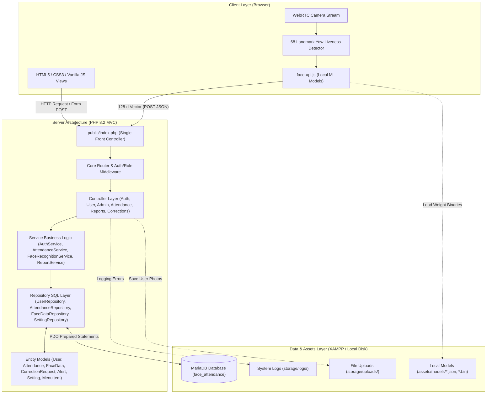
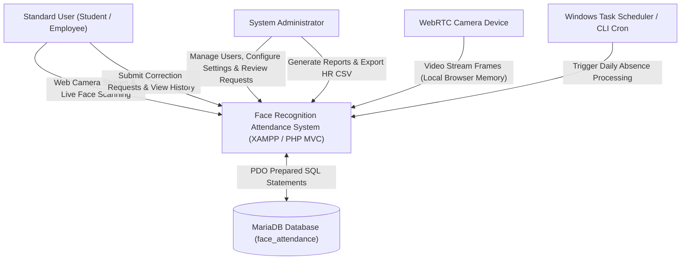
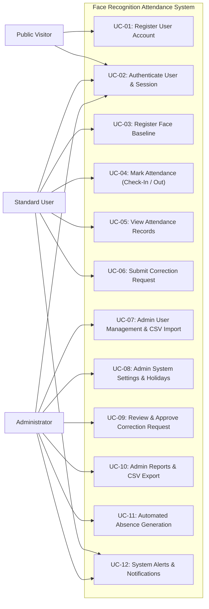
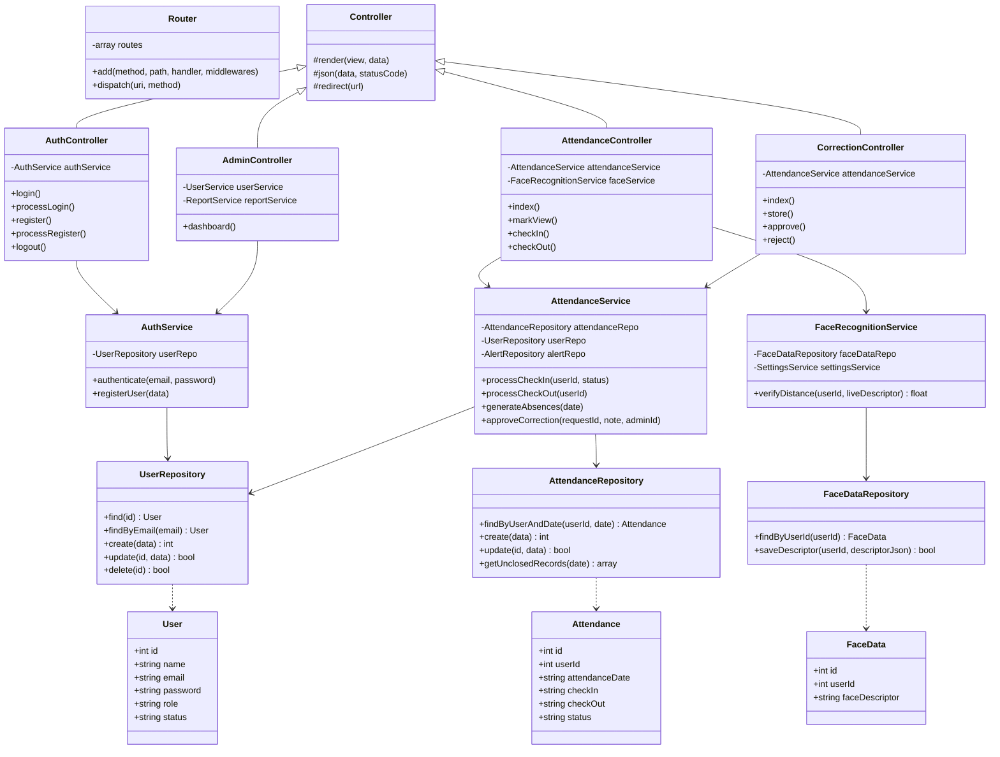
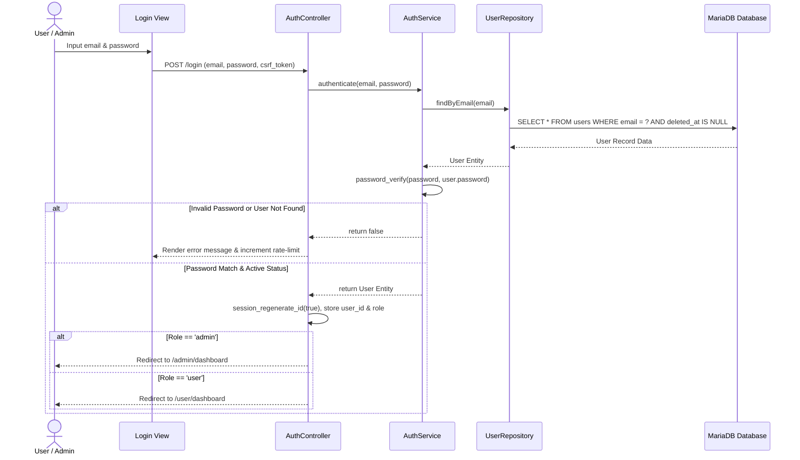
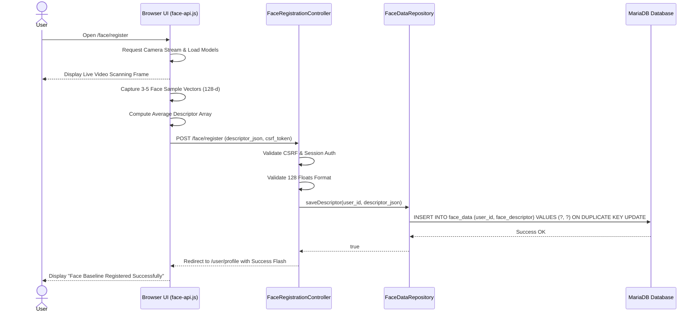
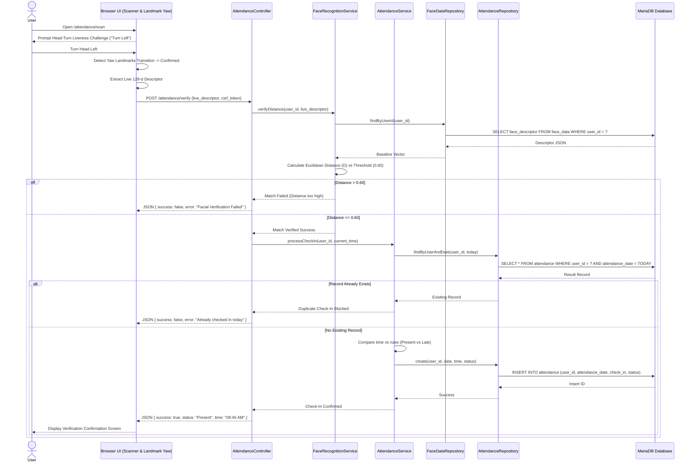
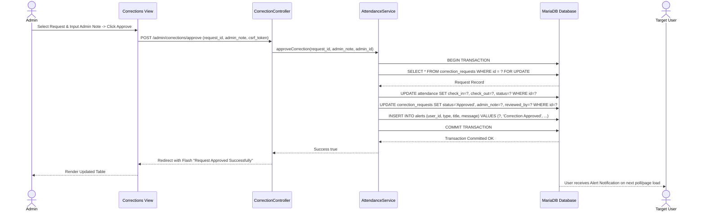
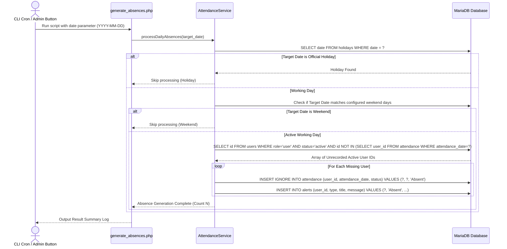
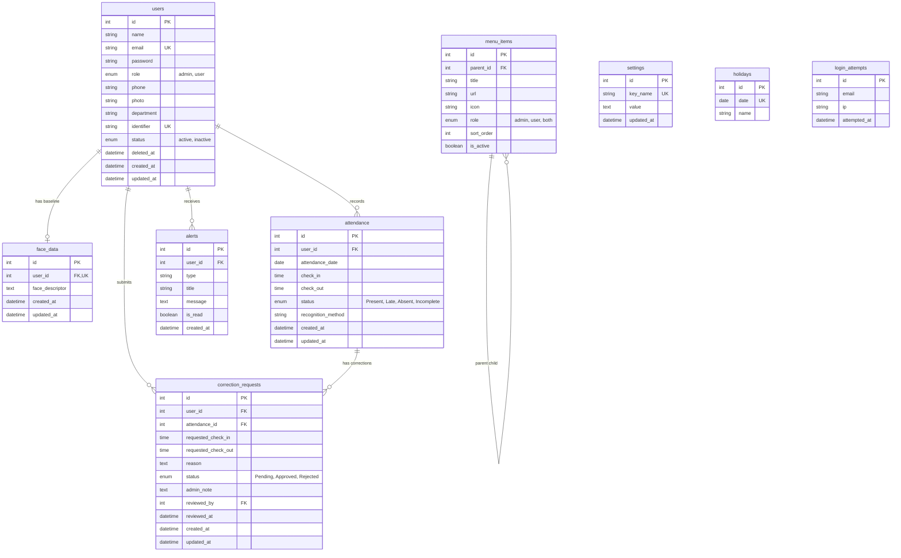

# System Design Document (SDD)
**Project:** Face Recognition Attendance System  
**Document Version:** 1.0.0  
**Date:** October 2026  
**Target Environment:** PHP 8.2 (XAMPP), MySQL/MariaDB, Native HTML5/CSS3/Vanilla JS (`face-api.js`)  

---

## 1. System Architecture & Viewpoints

### 1.1 High-Level Architecture Overview
The system follows a strict **Model-View-Controller (MVC)** architectural pattern enhanced by the **Repository Pattern** for database abstraction. Front-end biometric feature extraction occurs entirely in the user's web browser using local `face-api.js` models, while security enforcement, Euclidean distance computation, and business rules remain strictly on the server.



### 1.2 System Context Diagram



---

## 2. Use Case Viewpoint



---

## 3. Class Design & Structure Viewpoint



---

## 4. Dynamic Viewpoint (Sequence Diagrams)

### 4.1 Login Sequence



### 4.2 Face Registration Sequence



### 4.3 Check-In Verification Sequence



### 4.4 Correction Request Approval Sequence



### 4.5 Automated Absence Generation Sequence



---

## 5. Data Design & Database Schema

### 5.1 Entity-Relationship Diagram (ERD)



### 5.2 Complete Data Dictionary

#### Table: `users`
| Field | Type | Nullable | Key | Default | Description |
|---|---|---|---|---|---|
| `id` | `INT UNSIGNED` | No | PK | `AUTO_INCREMENT` | Unique user identifier. |
| `name` | `VARCHAR(100)` | No | | | Full user name. |
| `email` | `VARCHAR(150)` | No | UK | | User email address (unique). |
| `password` | `VARCHAR(255)` | No | | | Bcrypt password hash. |
| `role` | `ENUM('admin','user')`| No | | `'user'` | User authorization role. |
| `phone` | `VARCHAR(20)` | Yes | | `NULL` | Contact phone number. |
| `photo` | `VARCHAR(255)` | Yes | | `NULL` | Profile photo path. |
| `department`| `VARCHAR(100)` | Yes | | `NULL` | Department / Academic major. |
| `identifier`| `VARCHAR(50)` | No | UK | | Academic / Employee ID number. |
| `status` | `ENUM('active','inactive')`| No | | `'active'` | Account status flag. |
| `deleted_at`| `DATETIME` | Yes | | `NULL` | Soft-delete timestamp. |
| `created_at`| `DATETIME` | No | | `CURRENT_TIMESTAMP` | Record creation timestamp. |
| `updated_at`| `DATETIME` | No | | `CURRENT_TIMESTAMP` | Last update timestamp. |

#### Table: `face_data`
| Field | Type | Nullable | Key | Default | Description |
|---|---|---|---|---|---|
| `id` | `INT UNSIGNED` | No | PK | `AUTO_INCREMENT` | Descriptor record ID. |
| `user_id` | `INT UNSIGNED` | No | FK, UK | | Foreign key referencing `users(id)`. |
| `face_descriptor` | `LONGTEXT` | No | | | JSON array of 128 floats. |
| `created_at` | `DATETIME` | No | | `CURRENT_TIMESTAMP` | Enrollment timestamp. |
| `updated_at` | `DATETIME` | No | | `CURRENT_TIMESTAMP` | Last update timestamp. |

#### Table: `attendance`
| Field | Type | Nullable | Key | Default | Description |
|---|---|---|---|---|---|
| `id` | `INT UNSIGNED` | No | PK | `AUTO_INCREMENT` | Attendance record ID. |
| `user_id` | `INT UNSIGNED` | No | FK | | Foreign key referencing `users(id)`. |
| `attendance_date` | `DATE` | No | Composite UK | | Calendar date of attendance. |
| `check_in` | `TIME` | Yes | | `NULL` | Check-in timestamp. |
| `check_out` | `TIME` | Yes | | `NULL` | Check-out timestamp. |
| `status` | `ENUM('Present','Late','Absent','Incomplete')` | No | | `'Present'` | Evaluated attendance status. |
| `recognition_method` | `VARCHAR(50)` | No | | `'Face Recognition'` | Verification method used. |
| `created_at` | `DATETIME` | No | | `CURRENT_TIMESTAMP` | Insert timestamp. |
| `updated_at` | `DATETIME` | No | | `CURRENT_TIMESTAMP` | Update timestamp. |

#### Table: `correction_requests`
| Field | Type | Nullable | Key | Default | Description |
|---|---|---|---|---|---|
| `id` | `INT UNSIGNED` | No | PK | `AUTO_INCREMENT` | Request ID. |
| `user_id` | `INT UNSIGNED` | No | FK | | User requesting correction. |
| `attendance_id` | `INT UNSIGNED` | No | FK | | Target attendance record ID. |
| `requested_check_in` | `TIME` | Yes | | `NULL` | Proposed check-in time. |
| `requested_check_out`| `TIME` | Yes | | `NULL` | Proposed check-out time. |
| `reason` | `TEXT` | No | | | User justification reason. |
| `status` | `ENUM('Pending','Approved','Rejected')` | No | | `'Pending'` | Review workflow status. |
| `admin_note` | `TEXT` | Yes | | `NULL` | Administrator review note. |
| `reviewed_by` | `INT UNSIGNED` | Yes | FK | `NULL` | Admin ID reviewing request. |
| `reviewed_at` | `DATETIME` | Yes | | `NULL` | Timestamp of review. |
| `created_at` | `DATETIME` | No | | `CURRENT_TIMESTAMP` | Submission timestamp. |
| `updated_at` | `DATETIME` | No | | `CURRENT_TIMESTAMP` | Update timestamp. |

#### Table: `menu_items` (Self-Referencing Dynamic Menu)
| Field | Type | Nullable | Key | Default | Description |
|---|---|---|---|---|---|
| `id` | `INT UNSIGNED` | No | PK | `AUTO_INCREMENT` | Menu item ID. |
| `parent_id` | `INT UNSIGNED` | Yes | FK | `NULL` | Parent menu item ID (Self FK). |
| `title` | `VARCHAR(100)` | No | | | Display label. |
| `url` | `VARCHAR(150)` | No | | | Target routing URL. |
| `icon` | `VARCHAR(50)` | Yes | | `NULL` | SVG icon key string. |
| `role` | `ENUM('admin','user','both')` | No | | `'both'` | Permitted role view. |
| `sort_order` | `INT` | No | | `0` | Sequence ordering index. |
| `is_active` | `TINYINT(1)` | No | | `1` | Active visibility flag. |

---

## 6. Security Design & Safeguards

### 6.1 Authentication & Session Security
- **Passwords:** Hashed using `password_hash()` with `PASSWORD_BCRYPT` (work factor 10+). Plaintext passwords are NEVER saved, cached, or logged.
- **Session Tokens:** Configured with `session.cookie_httponly = 1`, `session.cookie_samesite = 'Lax'`, and `session_regenerate_id(true)` upon authentication changes. Idle sessions expire automatically after 30 minutes.
- **Rate Limiting:** `login_attempts` table records IP address and timestamp. 5 failed login attempts trigger a 15-minute IP lockout.

### 6.2 Authorization (RBAC) & CSRF Safeguards
- **Server Middleware:** Every protected route is passed through `AuthMiddleware` and `RoleMiddleware`. Hiding UI buttons/links is treated purely as a UI convenience; server enforcement returns HTTP 403 Access Denied if unauthorized.
- **CSRF Tokens:** All state-changing POST/PUT/DELETE endpoints validate cryptographically generated per-session tokens via `Csrf::verify()`.

### 6.3 Biometric Data Protection & Privacy
- **Zero Raw Images:** Camera streams operate strictly in browser memory. Video frames and raw facial images are NEVER sent over HTTP or stored on disk.
- **Biometric Vectors:** 128-dimensional floating-point arrays are stored in `face_data` and remain strictly private to the server. Biometric descriptors are never included in JSON API payloads returned to users.

---

## 7. Design Patterns & Implementation Strategy

1. **MVC Pattern:** Strictly separates core entities (`Models`), UI markup templates (`Views`), and workflow routing handlers (`Controllers`).
2. **Repository Pattern:** Encapsulates all SQL execution within dedicated Repository classes (`UserRepository`, `AttendanceRepository`, `FaceDataRepository`), keeping Controllers pure and database-agnostic.
3. **Singleton Pattern:** Used in `Database::getInstance()` to maintain a single reusable PDO connection handle across each request lifecycle.
4. **Service Layer Pattern:** Houses complex business logic (`AttendanceService`, `FaceRecognitionService`, `ReportService`) independently from controllers for clear testability.

---

## 8. UI Design & User Experience Specification

### 8.1 Page Inventory
The system provides a total of 18 distinct views across public, user, and administrative security scopes:

1. **Public Views:**
   - Landing Page (`/`): Public showcase featuring hero section, interactive face-scanning preview visual, system statistics counters, feature matrix, workflow guide, and security disclosures.
   - Login View (`/login`): Clean authentication form with password visibility toggle, rate-limit warnings, and CSRF protection.
   - Registration View (`/register`): Public self-registration form restricted to role `user`.
   - Error Views (`/403`, `/404`, `/500`): Custom styled error pages aligned with brand colors.

2. **User Views:**
   - User Dashboard (`/user/dashboard`): Personal status Overview, live digital clock, today's attendance badge, monthly attendance percentage meter, quick action buttons, and recent log feed.
   - Mark Attendance (`/attendance/scan`): Interactive showpiece camera view, corner bracket scanning UI, animated scan line, liveness challenge indicators, and result modal.
   - Register Face Baseline (`/face/register`): Multi-sample facial capture workflow with real-time feedback and sample progress bar.
   - My Attendance History (`/user/attendance`): Personal record list with search, status filters, date pickers, and pagination.
   - My Correction Requests (`/user/corrections`): List of submitted requests with live status badges and new request submission modal.
   - User Profile (`/user/profile`): Profile info editor, avatar picture upload, password change panel, and biometric status indicator.

3. **Admin Views:**
   - Admin Dashboard (`/admin/dashboard`): Animated system metrics counters, Chart.js graphs (daily, weekly, monthly, present vs absent), quick action bar, and real-time activity feed.
   - User Management (`/admin/users`): Paginated user table with search, role/department/status filters, CSV export, soft-delete confirmation modal, and reset face action.
   - User Form / Profile View (`/admin/users/create`, `/admin/users/edit?id={id}`): Detailed user account creation/editing modal and full attendance history.
   - CSV HR Import (`/admin/users/import-csv`): File upload interface with drag-and-drop zone and line-by-line validation log report.
   - Attendance Records (`/admin/attendance`): Master attendance view with advanced filtering, sorting, status badges, and CSV export button.
   - Correction Requests Review (`/admin/corrections`): Review queue with request inspection modal, admin note input, and Approve/Reject action triggers.
   - Reports & Analytics (`/admin/reports`): Interactive report generator with date range pickers, department breakdowns, late/absent summary tables, and UTF-8 BOM CSV exporter.
   - System Settings & Holidays (`/admin/settings`): Tabbed configuration form for working hours, late thresholds, recognition threshold, camera resolution, weekend selection, and academic holiday CRUD table.
   - Admin Profile (`/admin/profile`): Administrative account details and security password update form.

### 8.2 UI Navigation Map & Routing Tree

```
Public User
  ├── Landing Page (/)
  ├── Login (/login)
  └── Register (/register)
       │
 Authenticated User (Role: user)
  ├── User Dashboard (/user/dashboard)
  ├── Mark Attendance (/attendance/scan)
  ├── Register Face (/face/register)
  ├── My Attendance History (/user/attendance)
  ├── Correction Requests (/user/corrections)
  └── Profile Settings (/user/profile)
       │
 Authenticated Administrator (Role: admin)
  ├── Admin Dashboard (/admin/dashboard)
  ├── User Management (/admin/users)
  ├── HR CSV Import (/admin/users/import-csv)
  ├── Master Attendance Records (/admin/attendance)
  ├── Review Correction Requests (/admin/corrections)
  ├── Reports & Analytics (/admin/reports)
  ├── System Settings & Holidays (/admin/settings)
  └── Admin Profile (/admin/profile)
```

### 8.3 Scanning UI State Machine Specification

The showpiece facial scanning UI operates strictly through six deterministic states:

```
[State 1: Initializing Camera]
   │ (WebRTC MediaStream acquired & face-api.js models loaded)
   ▼
[State 2: Looking for Face]
   │ (Single face detected in video viewport)
   ▼
[State 3: Liveness Challenge Prompt]
   │ (User performs randomized head yaw turn - e.g. Left/Right)
   ▼
[State 4: Extracting Biometric Descriptor]
   │ (128-d vector generated from active canvas frame)
   ▼
[State 5: Server Verification & Distance Calculation]
   │ (Euclidean distance D calculated vs baseline)
   ▼
[State 6: Attendance Recorded Confirmation]
```

### 8.4 Application of Design System Tokens (SPEC §9)

All UI views strictly adhere to the brand design system defined in `SPEC.md` §9:

- **Primary Brand Colors:**
  - Ink (`--c-ink: #222831`): Sidebar background, primary action buttons, main heading text.
  - Slate (`--c-slate: #393E46`): Table headers, secondary text, component borders, hover states.
  - Stone (`--c-stone: #948979`): Muted text, structural dividers, visual icons, pending badges.
  - Sand (`--c-sand: #DFD0B8`): Main page background, soft container fills, contrast button text.
- **Derived Tints:** `--c-sand-light: #EFE6D5`, `--c-paper: #F7F1E5`, `--c-stone-soft: #C9BFAE`.
- **Semantic Status Indicators:**
  - `Present`: Soft Forest Green (`#4F7A5A`)
  - `Late`: Earthy Amber (`#B7791F`)
  - `Absent`: Muted Crimson (`#A8403A`)
  - `Pending`: Warm Stone (`#948979`)
- **Typography:** Self-hosted `.woff2` fonts (`Bricolage Grotesque` for headings 600–800, `Figtree` for body 400–600).
- **Animations:** CSS transitions on `transform` and `opacity` (stagger card reveal, scan line translation, modal scale-in, counter counter-up, pulsing alert indicator).

